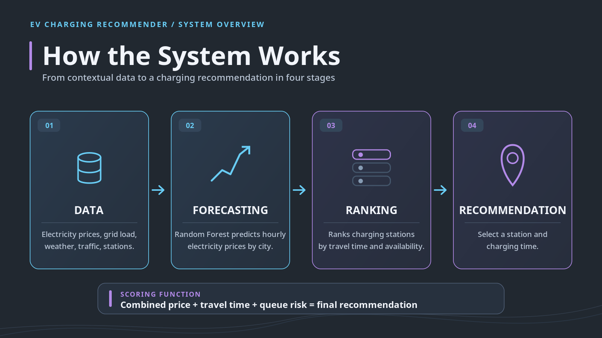
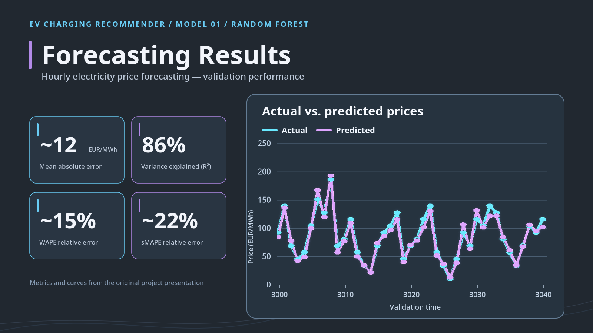
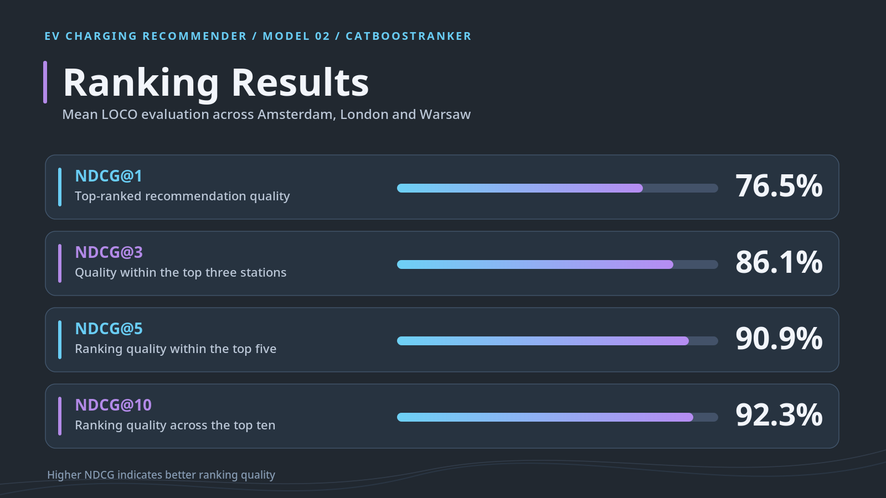

\# EV Charging Recommender — Engineering Thesis

Polish-Japanese Academy of Information Technology, Warsaw · 2025

For my engineering thesis, I developed a machine learning system to help EV drivers decide **where and when to charge**. The system combines hourly electricity price forecasting (Random Forest) with charging station ranking (CatBoostRanker). I evaluated it using data from Warsaw, Amsterdam, and London.

## System Architecture

## Model Evaluation

## Data Limitations

Live charger occupancy data was unavailable. Queue risk was estimated using station characteristics such as the number of charging points and city zone. **The ranking metrics reflect agreement with the project's scoring criteria**, not independently verified real-world waiting times.
